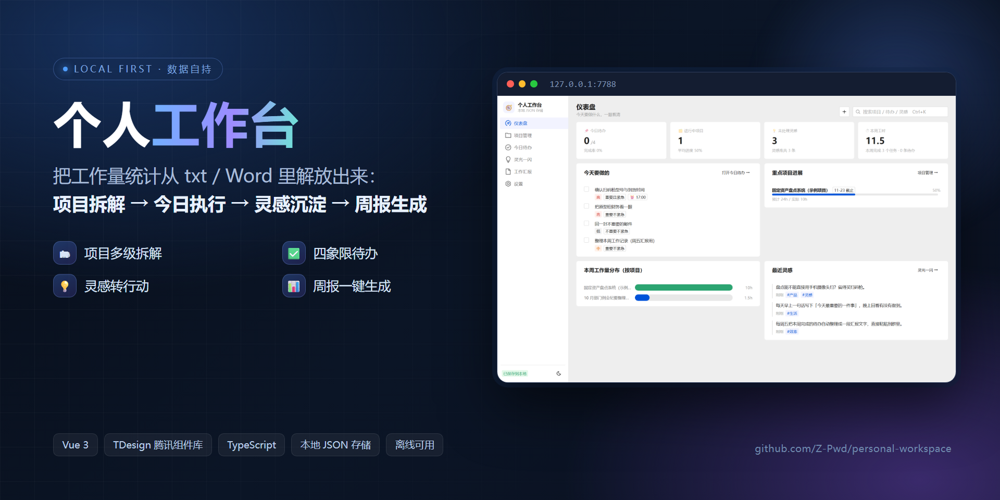
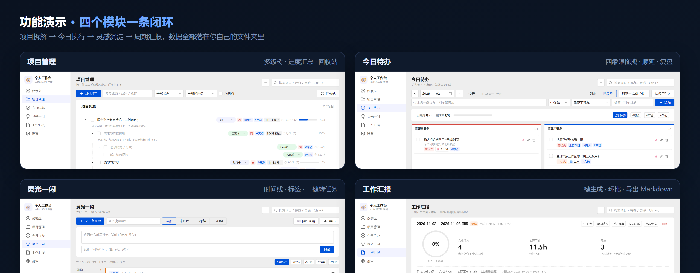

# 个人工作台 v2（Vue 3 + TDesign）

> 把工作量统计从 txt / Word / Excel 里解放出来的本地工作台　·　源码仓库 <https://github.com/Z-Pwd/personal-workspace>




把 txt / Word 里的工作量记录，变成**能拆解、能统计、能复盘**的本地工作台。

- **前端**：Vue 3 + **TDesign（腾讯开源组件库，tdesign-vue-next）** + TypeScript + Vite
- **存储**：JSON 文件，落在你指定的文件夹（默认 `项目目录/data`，设置页可改）
- **本地服务**：Node.js 标准库（`http` + `fs`），零第三方依赖，负责托管页面 + 读写 JSON
- **离线可用**：所有依赖都打包进 `dist/`，运行时不访问 CDN，也不上传任何数据

## 一、怎么用

1. 双击 **`启动工作台.bat`**（启动服务并自动打开浏览器）
2. 地址：`http://127.0.0.1:7788`
3. 第一次打开是空的 → 点「先看看示例数据」，或直接「建第一个项目」

> 关掉黑窗口 = 停止服务，数据已经写进文件，不会丢。

## 二、数据在哪

| 文件 | 内容 |
| --- | --- |
| `projects.json` | 项目树，子任务嵌套在 `children` 里；任务带 `doneAt`（完成时间）与 `timeLogs`（按天工时流水） |
| `todos.json` | 今日待办，按 `date` 区分每天 |
| `ideas.json` | 灵感，带标签与状态 |
| `reports.json` | 周报 / 月报存档（自动统计快照 + 手写内容） |
| `_backups/` | 自动备份（5 分钟最多一份，最多 60 份）+ 手动全量备份 |

设置页可改数据目录；每个文件带 `rev` 版本号，多标签页同时开会提示冲突；写入是「先写 .tmp 再改名」的原子操作，文件损坏时会另存 `.corrupt-时间戳` 现场。

## 三、功能



### 项目管理
- 多级树：项目 → 子任务 → 子子任务，展开/折叠
- 增删改；删除进回收站（可恢复 / 彻底删除 / 清空）
- 状态一键切换（行内下拉）、优先级、截止日期（临近/逾期高亮）
- 进度按子任务自动汇总；工时预计/实际，**实际工时可按天记流水**（周报按流水日期聚合，不再"改一次全算到本周"）
- 标签、备注、归档；搜索 + 状态/优先级筛选
- 批量：勾选后改状态、改优先级、删除
- 行内「⋯」菜单：加子任务、编辑、加入今日待办、上移/下移、归档、删除

### 今日待办
- 列表 / 四象限看板，**拖拽换象限**、拖到卡片上调整顺序
- 优先级 + 四象限；快速添加（回车）；置顶；标签筛选
- 从项目引入（完成后自动回写任务状态）
- 未完成顺延次日；每天/每周重复（完成后自动生成下一期）
- 每日复盘：完成数、完成率；日期切换查看历史；提醒时间到点提示

### 灵光一闪
- 随手记（Ctrl+Enter 保存）、标签、全文搜索、状态流转、收藏置顶
- 时间线展示、随机回顾
- 一键转成「今日待办」或「项目任务」，灵感自动标记已采纳
- 导出 Markdown / JSON

### 工作汇报
- 周报 / 月报一键生成，起止日期可自定义
- 自动汇总：概览、重点项目进展、四象限分布、未完成事项、灵感、下期要盯的任务
- 环比（与等长上一周期对比）、完成率环形图、每日工时柱状图
- 手动补充（总结 / 亮点 / 风险 / 下期计划）边打字边自动保存
- 存档、重新生成（保留手写内容）、导出 Markdown / 纯文本 / JSON、复制摘要
- 未完成事项一键顺延到下期

### 快速捕获（Ctrl+Shift+Space）
- 任意页面唤起浮层，一句话记下来，**边打边解析**：日期、`#标签`、`@项目`、`!高/!中/!低`、`3h`
- 三种落点：`回车` → 今日待办；`Ctrl+回车` → 灵感；`Ctrl+Shift+回车` → 项目任务（`@项目` 不存在会自动建项目）
- 支持「明天 / 后天 / 周五 / 下周三 / 3天后 / 11-20 / 11月25日 / 20号 / 半小时」等说法

### 全局
- 首页仪表盘：今日待办、项目进度、本周工时、工作量分布
- 全局搜索（Ctrl+K）：跨项目/任务/待办/灵感，点结果跳转并高亮
- 自动保存（0.4 秒）、备份与导入导出、深色模式
- **多标签页同步**：另一个标签页保存后，这边自动重新载入（有未保存改动时会先提示）
- **自适应布局**：内容区**铺满窗口**、顶栏与内容右边缘对齐（不再有右侧白边）；≤991 侧栏变抽屉（汉堡菜单）；≤767 顶栏两行、看板单列、项目树只留标题/状态/菜单；≤479 统计卡单列

### 界面截图

| 页面 | 预览 |
| --- | --- |
| 仪表盘 | [dashboard.png](docs/screenshots/dashboard.png) |
| 项目管理 | [projects.png](docs/screenshots/projects.png) |
| 今日待办（四象限） | [todos.png](docs/screenshots/todos.png) |
| 灵光一闪（时间线） | [ideas.png](docs/screenshots/ideas.png) |
| 工作汇报列表 | [reports.png](docs/screenshots/reports.png) |
| 周报详情 | [report-detail.png](docs/screenshots/report-detail.png) |
| 深色模式 | [dashboard-dark.png](docs/screenshots/dashboard-dark.png) |

> 截图由 `node scripts/capture.mjs` 自动生成（临时数据目录 + 示例数据，不会碰你的真实数据），封面图由 `node scripts/cover.mjs` 渲染。

## 四、TDesign 组件用在哪

| 位置 | 组件 |
| --- | --- |
| 侧边导航 | `t-menu` / `t-menu-item` + `tdesign-icons-vue-next` |
| 所有按钮、图标按钮 | `t-button`（primary / outline / text / danger） |
| 表单控件 | `t-input`、`t-textarea`、`t-input-number`、`t-select`、`t-date-picker`、`t-time-picker`、`t-switch`、`t-checkbox`、`t-radio-group` |
| 标签输入 | `t-tag-input`（任务/待办的标签） |
| 弹窗 | `t-dialog`（含 `DialogPlugin` 二次确认） |
| 提示 | `MessagePlugin`（`t-message`） |
| 状态/标签 | `t-tag`（优先级、截止、来源、标签） |
| 进度 | `t-progress`（行内、项目、周报环形图） |
| 布局 | `t-card`、`t-row`、`t-col`、`t-form`、`t-form-item` |
| 其他 | `t-timeline`（灵感）、`t-dropdown`（行内菜单/导出）、`t-tooltip`、`t-radio-group variant="outline"`（视图切换） |

> 备注：`t-radio-group` 的 `default-filled` 变体在「弹窗关闭时立刻切路由」的极端时序下会报一个 TDesign 内部的 `querySelector` 错误（上游异步测量泄漏），所以统一用 `variant="outline"`，视觉同样干净。

## 五、目录结构

```
workbench/
├─ 启动工作台.bat            # 双击启动（服务 + 打开浏览器）
├─ 重新编译.bat              # 改完源码后双击重新构建
├─ index.html                # Vite 入口
├─ vite.config.ts
├─ config.json               # 数据目录、端口
├─ server/server.mjs         # 本地服务：静态托管 + JSON 读写 + 备份
├─ src/
│  ├─ main.ts                # 应用入口（加载数据后挂载）
│  ├─ App.vue                # 布局：侧边菜单 + 顶栏 + 全局搜索
│  ├─ router.ts              # hash 路由
│  ├─ styles.css             # 基于 TDesign 令牌的布局样式
│  ├─ core/                  # 与框架无关的业务层
│  │  ├─ types.ts            # 所有数据结构
│  │  ├─ api.ts              # HTTP 通信
│  │  ├─ store.ts            # 全局状态（Vue reactive）+ 自动保存 + 冲突处理
│  │  ├─ tree.ts             # 项目树计算（进度/工时/查找）
│  │  ├─ report.ts           # 周报月报统计与导出
│  │  ├─ actions.ts          # 跨页面动作（引入待办、重复生成、状态回写）
│  │  ├─ search.ts focus.ts toast.ts theme.ts util.ts seed.ts
│  ├─ components/            # TaskDialog / TodoDialog / IdeaDialog / ConvertIdeaDialog
│  │                        # ProjectNode（递归树）/ TodoCard / BarChart
│  └─ views/                 # Dashboard / Projects / Todos / Ideas / Reports / Settings
├─ dist/                     # 构建产物（服务托管的就是这里）
├─ data/                     # 数据（可改到任意文件夹，已被 .gitignore 排除）
├─ docs/                     # README 封面图、功能演示图、界面截图
├─ test/                     # smoke-vue(48) + audit(41) + regression-v3(31) + nlp(31) + e2e-batch2(14) + e2e-extra(8) + responsive(11)
├─ LICENSE                   # MIT
└─ README.md
```

## 六、开发

```bash
git clone https://github.com/Z-Pwd/personal-workspace.git
cd personal-workspace
npm install          # 首次
npm run build        # 构建 dist/（等价于双击 重新编译.bat）
npm start            # 启动本地服务
npm run dev          # Vite 开发服务器（:5577，API 代理到 7788）
npm run test:v3      # 数据层回归（迁移 / doneAt / 工时流水 / 统计口径，31 项）
npm run test:nlp     # 自然语言解析单测（31 项）
npm run test:b2      # 快速捕获 / 批量导入 / 多标签同步（14 项）
npm run test:responsive  # 自适应布局：5 种宽度 × 6 个页面（11 项）
npm test             # 端到端冒烟测试（需先 npm start；用临时数据目录，不动真实数据）
```

## 七、备份、导入与恢复

**从文本批量导入**：设置页 →「从文本批量导入」，粘贴多行（一行一条待办，支持同一套语法），
预览确认后一键导入；行首的 `- ` `1. ` 会被自动去掉。


- 自动备份在 `data/_backups/`，文件名带时间戳；设置页可手动「立即全量备份」并查看列表
- 恢复：把备份文件复制回 `data/` 并改名成对应 JSON
- 也可在设置页「导出全部数据」得到完整快照，随时「导入数据」还原（会校验结构）

## 八、还没做（候选）

1. 汇报模板自定义（章节顺序、字段开关）
2. 导出 Word / PDF
3. 系统级通知（浏览器桌面提醒、周五早推送）
4. 季度报 / 按标签维度统计工时
5. 全局快速捕获（Ctrl+Shift+Space）+ 自然语言日期
6. CI（GitHub Actions 跑三套测试）+ vue-tsc 类型检查

## 九、隐私与安全

这个仓库是**可以公开的**：只包含代码、构建脚本和示例数据，不含任何真实工作内容。

| 不会进仓库的 | 原因 | 由谁拦住 |
|---|---|---|
| `data/`（四个 JSON + `_backups/`） | 你的真实项目、待办、灵感、汇报 | `.gitignore` |
| `config.json` | 记录你本机的数据目录路径 | `.gitignore` |
| `_review/` | 测试截图（可能包含本机路径） | `.gitignore` |
| `dist/`、`node_modules/` | 构建产物与依赖 | `.gitignore` |
| 任何密钥 / 令牌 / 账号 | 本工具不联网、不需要账号 | 无此类代码 |

另外：

- 运行时**零外网请求**（已用无头浏览器抓包验证：全部请求指向 `127.0.0.1`），数据只写本地文件
- 代码里的路径全部是**项目相对路径**，Chrome 位置可用 `CHROME_PATH` 环境变量覆盖，别人克隆后能直接跑测试
- 内置示例数据是虚构的演示内容，不来自任何真实工作记录

## 十、许可

本项目使用 [MIT License](LICENSE)，可自由使用、修改、分发（保留版权声明即可）。

## 十一、版本

- **v2.2**：新增「快速捕获」（Ctrl+Shift+Space，支持 `#标签` `@项目` `!优先级` 自然语言日期与工时）、文本批量导入、多标签页自动同步；确认弹窗改为组件式（修掉「清空全部数据」不可用的阻塞问题）
- **v2.1**：任务增加 `doneAt`（完成时间）与 `timeLogs`（工时流水），周报/仪表盘统一按流水日期统计；旧数据自动迁移（幂等）；待办卡片操作常显；TDesign 改为按需引入（包体 2.1MB → 1.4MB）
- **v2.0**：页面层重写为 Vue 3 + TDesign，业务逻辑层原样复用；数据格式与 v1 完全兼容（老数据直接可用）
- **v1.x**：TypeScript + 原生 DOM 手写组件（旧版源码保留在本地备份目录，未入库）
