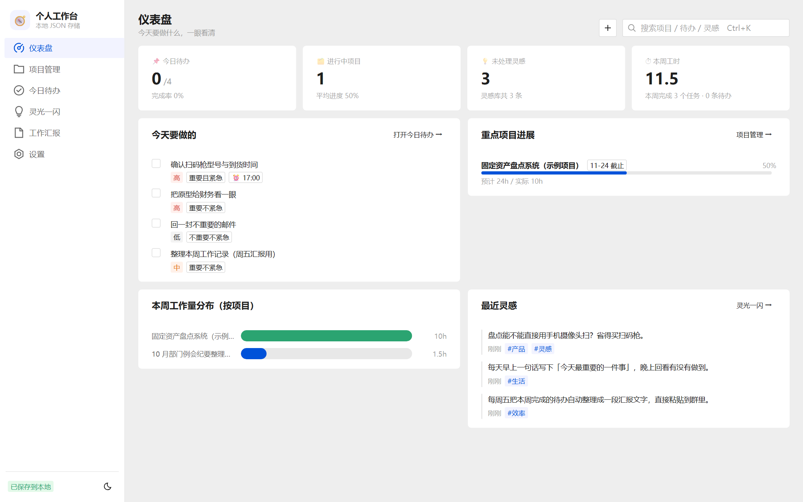
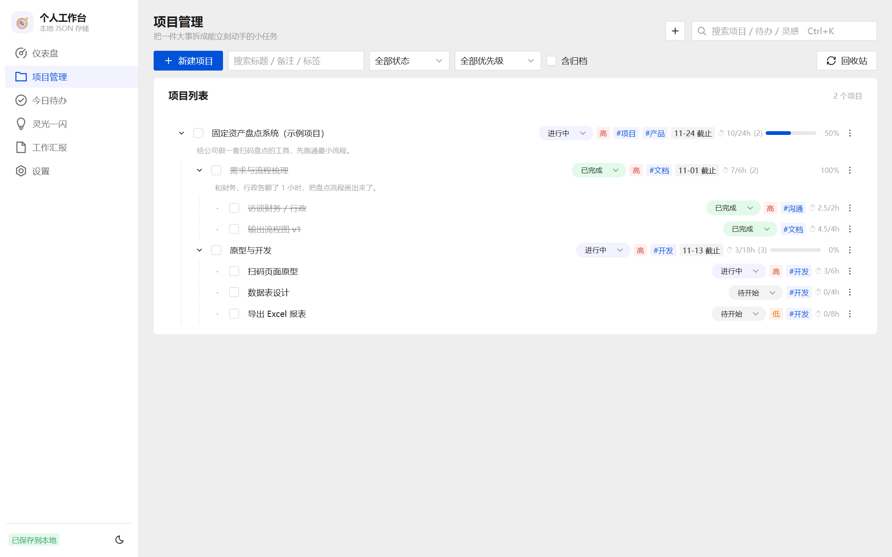
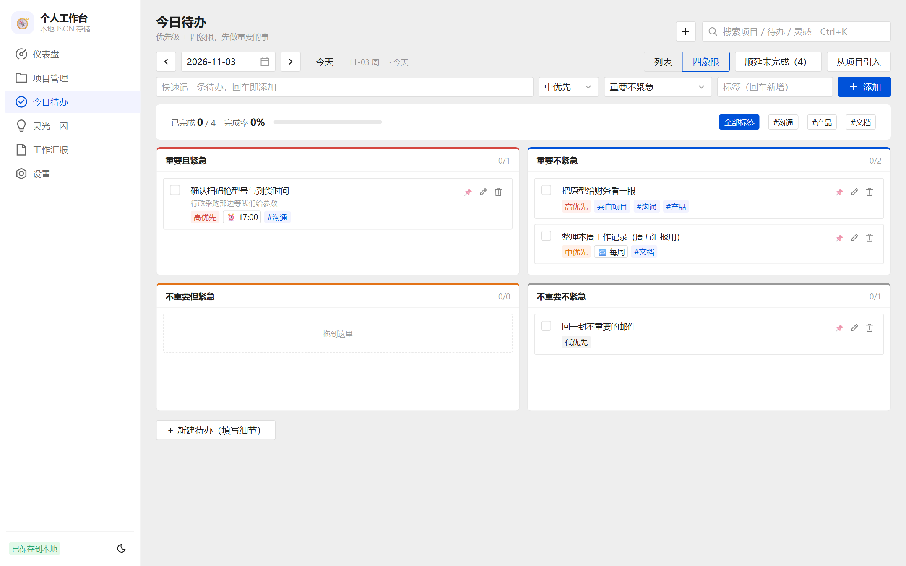
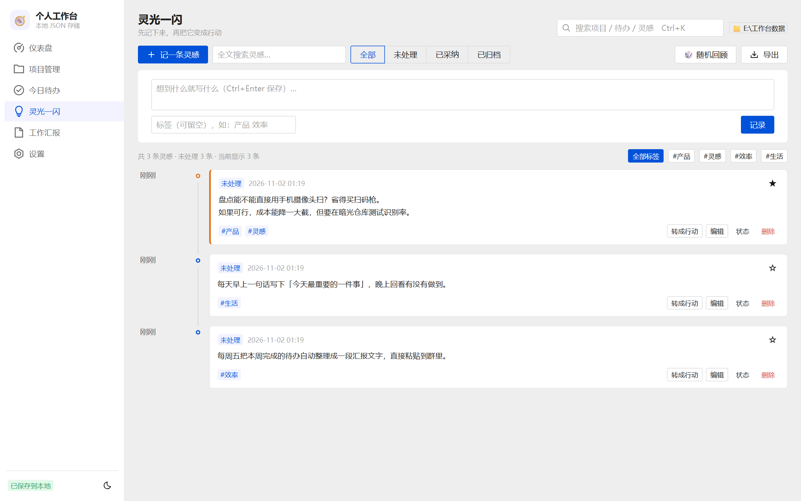
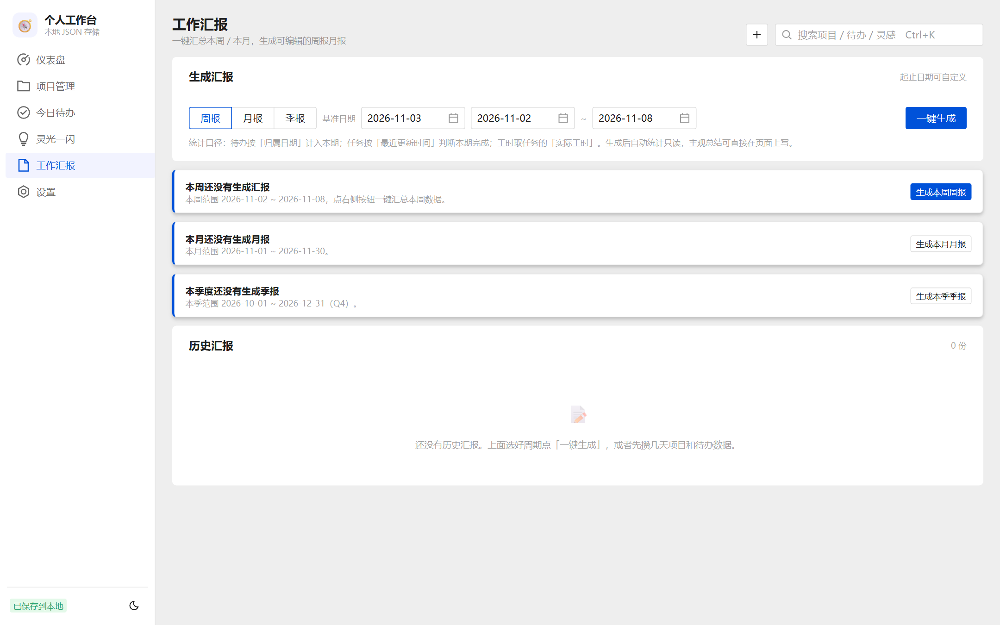
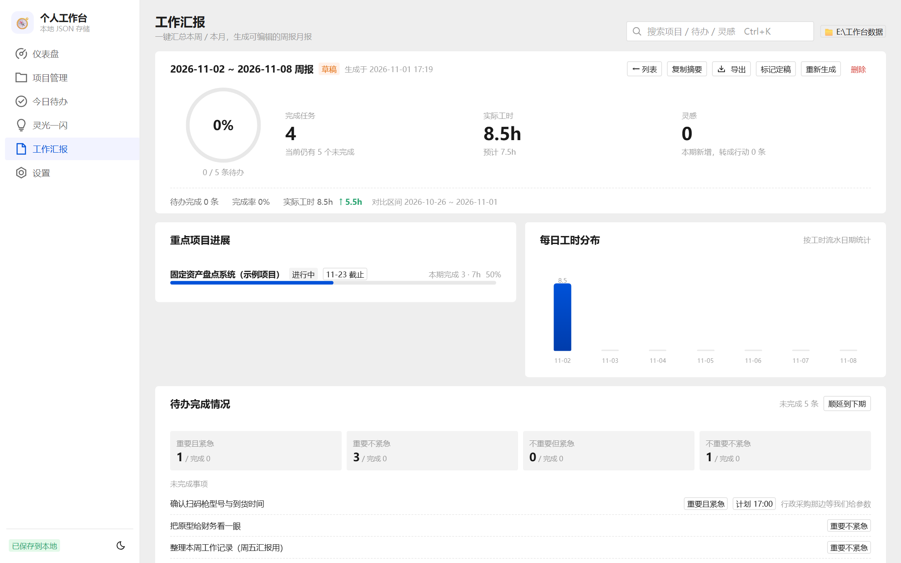
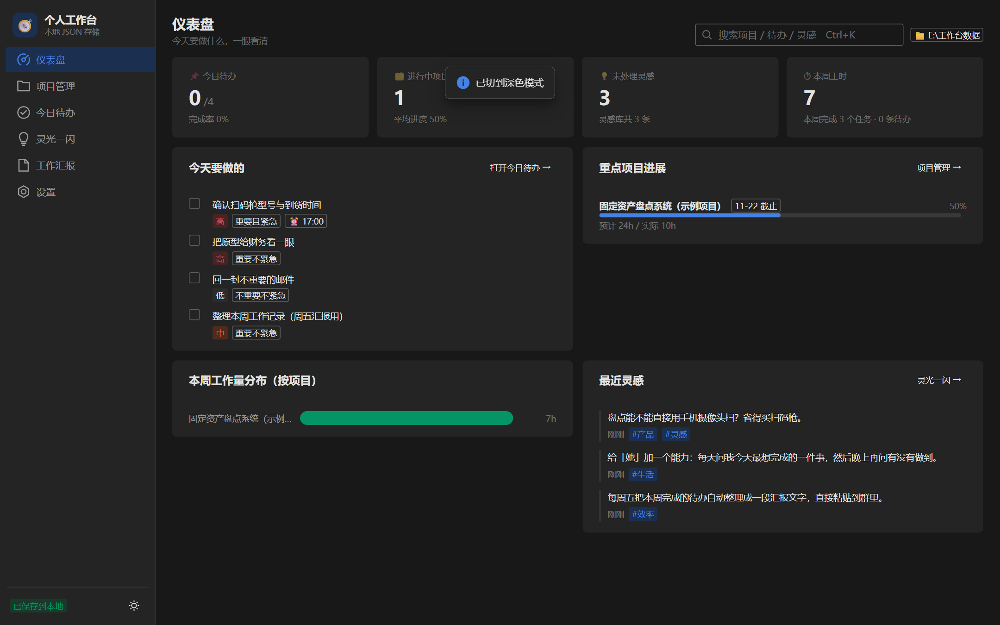

# 个人工作台 · Personal Workspace


> **一个把「项目拆解 → 今日执行 → 灵感沉淀 → 汇报输出」串成闭环的本地工作台。**
> 数据存在你自己电脑的文件夹里（JSON），腾讯 TDesign 界面，双击就能开，关掉也不丢。

---

## 一、它解决什么问题

| 常见困境 | 这个工作台的回答 |
|---|---|
| 事情散在聊天记录、便利贴、txt 里，周报要从零回忆 | 一条链路沉到底：项目 → 任务 → 待办 → 汇报，**周报一键生成** |
| 云笔记/在线工具要登录、要联网、数据不在自己手里 | 本地 Node 服务 + 本地 JSON，**运行时零外网请求** |
| 工时记了个总数，月底不知道时间花在哪 | **按天记工时流水**，报表按区间聚合，还能按项目、按标签看分布 |
| 每个公司周报格式都不一样，改起来只能手改 | **汇报模板**：章节顺序、标题、开关都能改，导出 Word 直接交 |


---

## 二、功能清单

### 仪表盘
- 今日待办完成率、进行中项目、未处理灵感、**本周工时**几个关键数
- 重点项目进度条、本周工作量分布（按项目）、最近灵感
- 首次打开可一键载入**示例数据**，先看效果再决定怎么用

### 项目管理
- **多级项目树**（不限层级），进度、工时按子任务自动汇总（只算叶子，不重复计）
- 任务字段：状态、优先级、截止、预计/实际工时、**工时流水（按天记录）**、标签、备注
- 行内直接改状态；批量勾选后批量改状态 / 删除 / 归档
- 筛选（全部 / 进行中 / 已完成 / 已归档）+ 回收站（可恢复、可彻底删除）
- 只有父任务没有子任务时，父任务自己的工时也会计入

### 今日待办（四象限）
- 看板 / 列表两种视图，支持**拖拽换象限**
- 自定义标签（自由输入 + 常用标签快选）、提醒时间、重复规则（每天 / 每周，完成后自动生成下一条）
- 一键把项目任务「引入今日」；未完成的**顺延到下期**
- 快速添加行：标题 + 优先级 + 象限 + 标签，回车即存
- 每日复盘小结

### 灵光一闪
- 时间线浏览、全文搜索、标签过滤、随机回顾
- 一条灵感可**一键转成任务或待办**，保留来源关系
- 导出全部灵感为 Markdown / JSON

### 工作汇报（周报 / 月报 / 季报）
- 一键生成：概览、重点项目进展、四象限分布、未完成事项、灵感、下期要盯的任务
- 环比（与等长上一周期对比）、完成率环形图、每日工时柱状图、**按标签工时**
- **模板自定义**：章节 ↑↓ 排序、标题改名、单章开关；对「新生成 / 重新生成」生效
- 手动补充（总结 / 亮点 / 风险 / 下期计划）边打字边自动保存
- 导出 **Word（.docx）** / Markdown / 纯文本 / JSON，一键复制摘要
- 未完成事项可一键顺延到下期；「重新生成」只刷新自动统计，手写内容保留

### 快速捕获（`Ctrl + Shift + Space`）
任意页面唤起一个输入框，**边打边识别**，回车即成：

| 写法 | 识别结果 |
|---|---|
| `明天` `后天` `大后天` `3天后` | 日期（也支持 `周五` `下周三` `11-20` `11月25日` `20号`） |
| `#周报` `#对账` | 标签（可多个） |
| `@固定资产` | 归属项目（不存在则自动新建） |
| `!高` `!中` `!低` | 优先级 |
| `2h` `2.5小时` `半小时` `一个半小时` | 工时（任务时写入预计工时） |

三个落点：`回车` → 今日待办；`Ctrl+回车` → 灵感；`Ctrl+Shift+回车` → 项目任务。
顶栏的 `+` 按钮是同样的入口（输入法占用快捷键时的备选）。

### 全局搜索（`Ctrl + K`）
跨项目、任务、待办、灵感搜索，点结果**跳转到对应页面并高亮定位**。

### 设置
- **数据目录**可改（换盘、放同步盘都行），改完立即生效
- 备份：单文档备份 / **一键全量备份**；每次保存前自动备份（同一文件 5 分钟内只留一份，最多保留 60 份）
- 导入导出：全部数据导出为单个 JSON；从文件导入覆盖
- **从文本批量导入**待办：多行粘贴 → 预览（自动套用快速捕获语法）→ 一键导入
- **定时提醒**：每周五 17:00 写周报 / 月末写月报，可改周几与时间，可申请系统通知
- 外观：亮色 / 深色 / 跟随系统；危险操作：清空全部数据（二次确认 + 自动备份）

### 多标签页同步
同一份数据开多个标签页时，任一标签保存后其它标签自动载入最新（有未保存改动会先提示）。

---

## 三、界面截图

| 仪表盘 | 项目管理 |
| --- | --- |
|  |  |

| 今日待办（四象限） | 灵光一闪 |
| --- | --- |
|  |  |

| 工作汇报列表 | 汇报详情 |
| --- | --- |
|  |  |

<details>
<summary>深色模式</summary>



</details>

---

## 四、快速开始

**环境要求**：Node.js 20.11+（推荐 22），Windows / macOS / Linux 都可以。

### 方式一：双击（Windows）
1. 双击 `启动工作台.bat` → 自动起服务并打开 <http://127.0.0.1:7788>
2. 改了代码后双击 `重新编译.bat`，再刷新页面

### 方式二：命令行
```bash
npm install          # 首次
npm run build        # 构建到 dist/
npm start            # 起服务（默认 7788 端口）
npm run dev          # 开发模式（Vite :5577，API 代理到 7788）
```

首次打开是空的，点「先看看示例数据」可以先体验完整流程，再在设置里清空。

---

## 五、数据在哪、怎么备份

```
<数据目录>/
├─ projects.json     项目与任务（多层树）
├─ todos.json        今日待办
├─ ideas.json        灵感
├─ reports.json      汇报（含生成时的统计快照）
├─ templates.json    汇报模板
└─ _backups/         自动备份（按时间命名，可随时回退）
```

- 数据目录默认是**项目目录下的 `data/`**，可在「设置 → 数据存储」改成任意路径
- 每次写盘前自动备份、**原子写入**（先写临时文件再替换），避免半截文件
- 保存带**版本号校验**：两个标签页同时改不会互相覆盖，后写的一方会收到冲突提示并可载入最新
- 想换电脑：把整个数据目录拷过去，改一下设置里的路径即可

---

## 六、技术架构

| 层 | 选型 |
| --- | --- |
| 前端框架 | Vue 3.5 + `<script setup>` + TypeScript（strict） |
| UI 组件 | TDesign Vue Next 1.20（Tabler 风格中文组件库），按需引入 |
| 构建 | Vite 6 + esbuild，产物约 1.4 MB（gzip ~250 KB） |
| 路由 | vue-router 4（hash 模式，本地服务零配置） |
| 后端 | 单个 Node 文件 `server/server.mjs`，只用标准库 `http`/`fs`，**无 Express** |
| 存储 | 本地 JSON 文件 + 原子写 + 备份 + rev 乐观锁 |
| 运行时依赖 | 无 CDN、无外网请求、无数据库 |

### 目录结构

```
├─ index.html                 Vite 入口
├─ src/
│  ├─ App.vue                 布局、侧栏、顶栏、全局快捷键、定时提醒
│  ├─ core/                   纯逻辑层（可单测，不依赖 DOM）
│  │  ├─ types.ts               全部数据结构定义
│  │  ├─ store.ts               全局状态、自动保存、版本冲突、多标签同步
│  │  ├─ tree.ts / task-ops.ts  树遍历、进度与工时汇总、状态机、数据迁移
│  │  ├─ report.ts              周/月/季周期计算、统计聚合、Markdown 导出
│  │  ├─ report-template.ts     汇报模板（章节顺序/标题/开关）
│  │  ├─ nlp.ts                 快速捕获语法解析（日期/标签/项目/工时）
│  │  ├─ docx.ts + zip.ts       Word 导出（手写 OOXML + 零依赖 ZIP）
│  │  ├─ reminder.ts            定时提醒（纯函数判定 + 轮询）
│  │  └─ api.ts / sync.ts / toast.ts / confirm.ts …
│  ├─ components/             可复用组件（项目树节点、各类弹窗、捕获浮层…）
│  └─ views/                  六个页面（仪表盘/项目/待办/灵感/汇报/设置）
├─ server/server.mjs          静态托管 dist/ + JSON 读写 + 备份 + 版本校验
├─ test/                      九套自动化测试
├─ scripts/                   构建、截图、封面生成
└─ docs/                      README 用图
```

### 几个关键设计

- **逻辑与界面分离**：`core/` 里是可单测的纯函数，视图只负责渲染，改 UI 不影响数据正确性
- **工时是流水不是字段**：`timeLogs: [{date, hours, note}]`，报表按日期区间聚合，跨周跨月都算得对
- **完成时间独立**：`doneAt` 与 `updatedAt` 分开，改一个错别字不会把任务算到本期完成
- **报告快照冻结**：生成时把统计和模板一起存进 `snapshot`，之后改数据不影响历史报告，除非点「重新生成」
- **零依赖导出**：Word 由自己写的 ZIP + OOXML 生成，不引第三方库，也不上传到任何服务器

---

## 七、测试

九套自动化，共 **225 项**，全部通过；`vue-tsc` 类型检查 0 错误；GitHub Actions 每次 push 自动跑。

| 命令 | 内容 | 项数 |
| --- | --- | --- |
| `npm run test:nlp` | 自然语言解析（14 种日期写法、工时、组合语法） | 31 |
| `npm run test:reminder` | 提醒触发判定（周末/月末/去重/开关） | 11 |
| `npm run test:v3` | 数据层回归（迁移、doneAt、工时流水、统计口径、清空数据） | 31 |
| `npm test` | 端到端冒烟（建项目/任务/待办/灵感/汇报/设置/深色） | 48 |
| `npm run audit` | 按真人路径逐项点击的功能审计 | 41 |
| `npm run test:extra` | 导出内容、导入、改数据目录、零外网、409 冲突 | 8 |
| `npm run test:b2` | 快速捕获、文本批量导入、双标签页同步 | 14 |
| `npm run test:b3` | 汇报模板、Word 导出、季报、提醒持久化 | 21 |
| `npm run test:responsive` | 7 种宽度 × 6 个页面：无横向溢出、右边缘对齐、抽屉菜单 | 20 |
| `npm run typecheck` | TypeScript + 模板类型检查（含 `.vue`） | — |
| `npm run test:all` | 一次跑完上面所有测试（需先起服务） | 225 |

测试用**无头 Chrome + CDP**驱动真实页面（不是 jsdom），并统一使用临时数据目录，**不会碰你的真实数据**。

```bash
npm start                 # 另开一个终端
npm run test:all
```

---

## 八、已知限制

| 限制 | 说明 |
| --- | --- |
| 单用户本地工具 | 没有账号体系、没有多人协作，也**不打算**加（那会变成半个 SaaS） |
| 记录量级 | 单文档几千条以内很流畅；设计目标是个人使用，不是团队知识库 |
| Word 导出不压缩 | 文件比 Office 生成的大几倍（周报体量无感） |
| 模板只有一套 | 暂不支持"多套模板按甲方切换" |
| 提醒依赖页面开着 | 浏览器定时器；关掉标签页不会响（系统级提醒需要任务计划） |
| 季报按自然季度 | 不支持自定义财年 |

---

## 九、隐私与安全

- **数据 100% 在本地**：不登录、不上传、不统计；运行时不请求任何外部地址（有自动化测试校验）
- **不入库的文件**：`data/`、`config.json`、`_review/`、`dist/`、`node_modules/`、日志、测试产物（`.gitignore` 已排除，且历史提交从未包含）
- **不含个人信息**：源码与截图中无本机路径、账号、密钥；示例数据为虚构内容
- 想更保险：`git add` 后先 `git status` 看一眼，别用 `git add -f` 强加数据目录

---

## 十、路线图

- [x] 项目管理 / 待办四象限 / 灵感 / 周报月报 / 全局搜索
- [x] 工时流水、完成时间、按标签工时、季度报
- [x] 快速捕获 + 自然语言日期 + 文本批量导入 + 多标签同步
- [x] 汇报模板、Word 导出、定时提醒
- [x] 自适应布局（宽屏铺满、平板抽屉、手机单列）
- [x] 类型检查 + CI
- [ ] PWA（可安装、离线可用）
- [ ] 日历热力图（贡献图风格）
- [ ] 接入本地 LLM 自动写总结（Ollama）

---

## 十一、许可

[MIT](LICENSE) © 2026 Z-Pwd

如果这个工作台帮你省下了写周报的时间，给个 ⭐ 就够了。

---

## 十二、版本记录

- **v2.3**：汇报模板自定义（章节顺序/标题/开关）、Word（.docx）导出、季报、按标签工时、定时提醒；新增 `vue-tsc` 类型检查与 GitHub Actions CI
- **v2.2**：快速捕获（Ctrl+Shift+Space）+ 自然语言日期、文本批量导入、多标签页同步；宽屏铺满与全站自适应
- **v2.1**：任务完成时间 `doneAt`、工时改为按天流水、周报/仪表盘统计口径统一、TDesign 按需引入（包体减半）
- **v2.0**：Vue 3 + TDesign 重写页面层，保留数据与逻辑层
- **v1.0**：本地 Node 服务 + JSON 存储的第一个可用版本（项目树 / 待办 / 灵感 / 周报）
